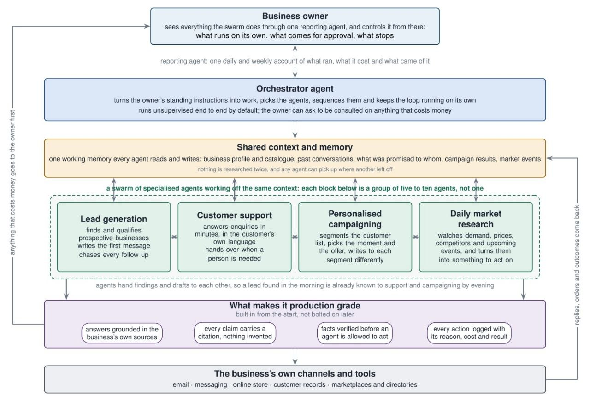
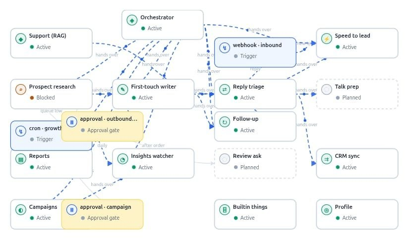
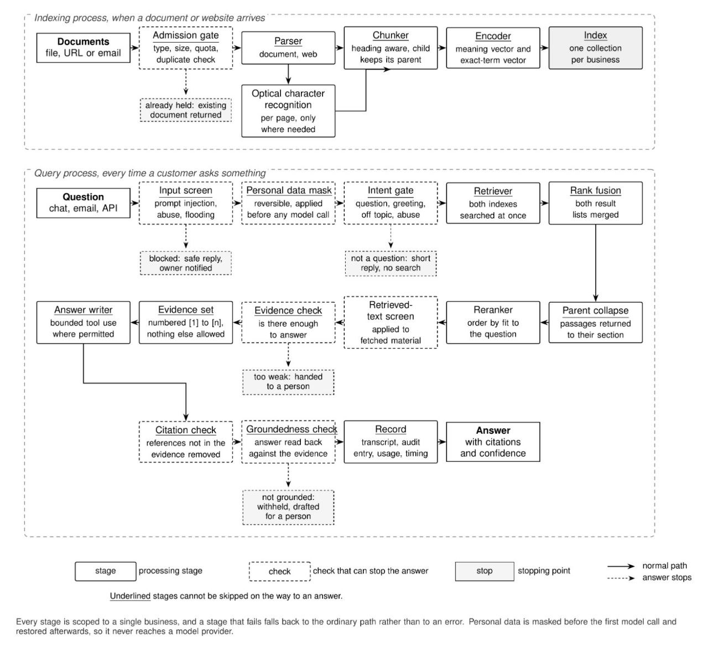

# B Swarm

**An autonomous swarm of AI agents designed to keep sales and customer operations moving 24/7 for small businesses.**

We are building a system that carries business context from one task to the next: answering an enquiry, researching a prospect, preparing outreach, following up, handling a reply and updating the customer record. The owner sets the direction, chooses the level of autonomy and can inspect what the swarm is doing.

[The problem](#the-problem) · [What we are building](#what-we-are-building) · [A customer workflow](#a-customer-workflow) · [The swarm](#the-swarm) · [Custom orchestration](#custom-orchestration) · [Knowledge and retrieval](#knowledge-and-retrieval) · [Shared context](#shared-context) · [Owner control](#owner-control-and-observability) · [External agents](#external-agents-and-assistants) · [Technology](#technology) · [What we want to demonstrate](#what-we-want-to-demonstrate)

## The problem

A small business owner often becomes the link between every tool the business uses. Customer enquiries arrive in one place, leads are stored in another, campaigns run separately and the CRM needs updating after each interaction. The owner has to remember what happened and decide what comes next.

When that coordination breaks down, a customer waits for a reply, a prospect misses a follow-up or the next message ignores information the customer has already provided. Keeping those steps moving takes time and staffing, even when each individual tool works.

We want to reduce that coordination work. The goal is fewer missed enquiries and sales opportunities, consistent customer communication and routine work that continues outside the owner's working hours.

## What we are building

B Swarm connects specialised agents through shared business information and workflow state. Each agent has a defined responsibility, and its output becomes useful context for the next step. A lead should carry its research, conversation, approval history and follow-up state through the whole workflow.

| Business need | What B Swarm is designed to do |
| --- | --- |
| Accurate customer replies | Retrieve relevant business information, answer enquiries and route uncertain or sensitive cases for review. |
| Lead discovery and research | Find prospects, read their websites, collect useful facts and prepare research for outreach. |
| Personalised outreach | Draft first-touch messages using the business profile, prospect research and relevant source material. |
| Follow-ups and reply handling | Schedule the next step, interpret incoming replies, pause the cadence when a reply arrives and suppress further outreach after an opt-out. |
| Campaigns | Prepare messages for customer segments, apply the selected approval policy and track message outcomes. |
| Meeting workflows | Help customers schedule meetings and bring lead research, conversation history and business information into meeting preparation. |
| CRM and store context | Keep customer records aligned with interactions and bring connected catalogue and order information into relevant workflows. |
| Insights and reports | Surface useful business signals and summarise activity, message outcomes and work that needs owner attention. |
| External-agent access | Let a compatible assistant discover the swarm and request business workflows through MCP and A2A. |

We want these capabilities to work as one product. For example, research collected for outreach should also help the agent handling the prospect's reply and the owner preparing for a meeting.

<details>
<summary><strong>Open the business workflow details</strong></summary>

- **Research:** combine the business's ideal customer profile with prospect discovery, website reading, deduplication, configured enrichment and email verification. Save the findings before preparing outreach.
- **Inbound enquiries:** bring website and connected marketplace leads into the same intake flow, capture stated requirements, notify the owner and request CRM sync.
- **Campaigns:** form audiences from customer and order records, including new, repeat, high-value and at-risk customers. Carry the selected audience, offer and draft text into approval so the owner can inspect what will run.
- **Follow-ups:** use the prior thread and configured cadence. Replies and opt-outs change the next action instead of being treated as another message to send.
- **Insights:** connect changes in the business's own numbers, relevant website changes, news and events to actions worth considering.
- **CRM continuity:** mirror lead changes and newer conversation notes to the connected CRM, with recorded failures and retry handling.
- **Reporting:** combine recorded metrics such as lead stages, message outcomes, reply timing and usage with a readable summary and PDF report.
- **Meeting and feedback workflows:** help with availability and scheduling, and extend the same shared context into meeting briefs and post-delivery feedback requests.

</details>

## A customer workflow

The diagrams are design sketches of the product we are building. Their state labels, group sizes and timing are illustrative; production-grade and universal-verification labels describe engineering goals. Autonomy follows the owner's configured policy.

[](./workflow.jpg)

*Business workflow design. The owner sets direction and receives a view of the work, while the swarm carries context between customer operations.*

Consider an owner asking: **"Research suitable prospects and prepare outreach for this week's offer."**

1. The orchestrator reads the business profile and requests a research run.
2. Research collects prospect information and stores the findings against the leads.
3. The approval policy determines whether the owner reviews the batch or individual drafts.
4. The outreach workflow uses the profile and research to prepare relevant messages.
5. Scheduled dispatch applies send windows, caps and suppression checks before sending through a configured channel.
6. An incoming reply pauses further follow-ups while the reply handler determines the next step.
7. CRM sync carries the updated customer state into the connected CRM. An opt-out suppresses further outreach.
8. Reports and activity records give the owner a view of outcomes and pending work.

That sequence combines model reasoning with explicit application logic. A reply, approval or schedule changes the workflow through stored state rather than requiring the owner to start every step manually.

## The swarm

[](./agent_diagram.jpg)

*Agent and handoff design. Triggers, approval gates and service capabilities appear alongside agents because they are part of the same workflow.*

The swarm is organised around responsibilities:

- **Orchestrator:** translates an owner's question into platform reads or requested work and explains the results.
- **Business profile:** maintains the context other agents need, including what the business sells, its audience and its communication style.
- **Customer support:** combines conversation context, business knowledge and permitted actions to handle enquiries.
- **Growth workflows:** research prospects, compose outreach, manage follow-ups, process replies and handle inbound leads.
- **Campaigns and insights:** connect customer segments and business signals to useful actions.
- **CRM and reporting:** carry outcomes into customer records and make the work visible to the owner.
- **Shared capabilities:** supply reusable actions such as customer lookup, knowledge retrieval, order data and booking tools.

An agent can be a bounded model-driven loop or a specialised service pipeline. A trigger or booking tool does not need its own independent model loop. Coordination comes from clear responsibilities, shared records and explicit handoffs.

## Custom orchestration

**Our agent runtime uses a custom Python orchestration layer. It does not use LangGraph or LangChain to execute the agents.**

We use Python control flow, async services, tool schemas, stored workflow state and a job dispatcher to coordinate the system. Model adapters call provider APIs directly through HTTPX. Models handle tasks such as drafting, classification and summarisation; the surrounding harness controls context, tools, execution limits and business workflow transitions.

<details>
<summary><strong>Open the agent harness: context, model calls and tool execution</strong></summary>

The owner-facing orchestrator follows a bounded tool-calling cycle:

1. Build the system context from business information and owner instructions.
2. Resolve the configured model for the agent.
3. Send the context, question and available tool schemas to the model.
4. Parse any structured tool calls returned by the model.
5. Dispatch each call to a registered Python handler.
6. Feed the structured results back into the conversation.
7. Return an answer when the model finishes, or use a final wrap-up after the tool-round limit.

The owner-facing loop is capped at six tool rounds. The support harness has its own configurable iteration, time, token and tool-call budgets. Read-only tool batches can run concurrently; actions that change business state are dispatched sequentially in that loop.

```text
Owner question + business context + tool schemas
                       |
                 Model API call
                       |
              Answer or tool request
                       |
                Python dispatcher
                       |
       Stored-data read, action or queued job
                       |
              Structured tool result
                       |
          Next model turn or final answer
```

The tool registry exposes platform operations such as listing leads, reading profile facts, inspecting approvals, retrieving reports, checking agent activity, requesting research and drafting campaigns. Unknown tools and handler failures return structured errors for the orchestrator to interpret.

The support runner adds retrieval, evidence assembly, conversation history, citation handling and action execution around its model calls. The harness owns these mechanics rather than delegating them to a graph framework.

</details>

<details>
<summary><strong>Open the background runtime: schedules, events and jobs</strong></summary>

The 24/7 design comes from recurring schedules and incoming events. A webhook can start reply handling or lead ingestion; a scheduled tick can request dispatch, follow-up work, research, reporting, insights or CRM retries.

The job dispatcher maps a job kind to a Python service handler. The handler loads the relevant business state, performs its step and writes an outcome or requests further work. This keeps long-running business operations outside a single conversational model turn.

The queue abstraction supports a local async queue for development and a QStash-backed callback queue for hosted operation. Local tasks run in the application process; the hosted queue uses an external delivery service. Continuous operation depends on a deployed backend, configured schedules and working integrations.

The owner-facing answer must distinguish a **queued request** from a **completed action**. Queuing a campaign or report means the work has been requested; its later status records whether it ran, failed or needs attention.

</details>

<details>
<summary><strong>Open structured actions and workflow state</strong></summary>

Reusable action handlers separate model intent from business execution. The action layer defines the inputs an operation accepts and selects the handler that performs it. Booking, customer lookup and other capabilities can therefore be shared across conversational and scheduled workflows.

For guided procedures, workflow records carry the current step, collected variables, a procedure snapshot and a branch log. The runtime reconstructs that state on the next turn instead of depending on an uninterrupted model conversation.

This gives us a concrete place to improve interruption handling: expose what completed, what remains pending and what information or owner decision is needed before work continues.

</details>

## Knowledge and retrieval

The agents need the business's own information: products, prices, policies, services and the context of earlier interactions. We are building a retrieval pipeline that brings relevant source material into a bounded answer context.

[](./rag_sys_design.jpg)

*Retrieval and evidence design. Evidence and privacy gates express the intended safeguards; their behaviour follows configured policies. Qdrant collections are organised by embedding model with business filters, rather than the per-business collection layout in this sketch.*

<details>
<summary><strong>Open the ingestion pipeline</strong></summary>

- **Admission:** check supported types, upload size, quotas and duplicate content before processing a source.
- **Parsing:** extract text from documents and websites. Parsers cover PDF, Word, spreadsheet and presentation formats; Crawl4AI handles website ingestion.
- **Structure:** split material into heading-aware chunks with parent-child relationships so related passages retain their document context.
- **Encoding:** create dense semantic vectors and sparse keyword representations.
- **Indexing:** store searchable content in model-specific Qdrant collections with business-scoped metadata and query filters, while PostgreSQL retains source and document records.

The design includes page-level OCR where needed. Source records and indexing status give the owner a place to inspect the material used by the agents.

</details>

<details>
<summary><strong>Open the enquiry-to-answer pipeline</strong></summary>

1. Screen the input, apply configured personal-data masking and classify the intent.
2. Retrieve relevant passages through semantic and keyword search.
3. Fuse the result rankings, apply metadata filters and optionally rerank the candidates.
4. Deduplicate related chunks and assemble an evidence set within the context budget.
5. Combine that evidence with the business instructions and selected conversation history.
6. Generate an answer or execute permitted tools through the custom support loop.
7. Apply citation and configured grounding checks, then record the transcript, usage and timing.

Hybrid search combines dense embeddings with sparse keyword retrieval using reciprocal rank fusion. Keyword matching helps preserve exact product names, identifiers and terms, while semantic search handles differently phrased questions. Optional rerankers can order the retrieved candidates by relevance.

The context assembler uses estimated token budgets and trims older history while preserving instructions and selected evidence. Numbered evidence references let the answer refer back to retrieved material.

Our reliability goal is to handle missing information explicitly and route uncertain cases for review when the policy requires it. A citation identifies a source; grounding checks still need to assess whether the source supports the answer. Configurable advisory and blocking policies determine how verification results affect a workflow.

</details>

## Shared context

Shared context includes more than a common system prompt. It combines source knowledge with the current state of the business workflow.

| Context | Why the next step needs it |
| --- | --- |
| Business profile and catalogue | Keep the audience, offers, pricing context and communication style consistent. |
| Prospect research and lead state | Avoid losing the facts collected before outreach and show where a lead is in the workflow. |
| Conversation and message records | Know what the customer asked, what was sent and whether further follow-up should pause. |
| Approval records | Carry the owner's decision or edit into the action that follows. |
| Campaign and integration outcomes | Connect message results, store information and CRM updates to later work. |
| Source and evidence records | Identify the business material used to prepare an answer or draft. |

PostgreSQL stores the structured records, Qdrant supports knowledge retrieval, and Redis supports caching and send locks. Agent handlers pass the business identifier through their operations so work can be organised around the appropriate business context.

This makes handoffs inspectable. The next agent reads the relevant records and current state rather than assuming that another agent completed a task because it said so in a conversation.

## Owner control and observability

Autonomy means routine work can proceed under the owner's instructions. The owner chooses the approval policy and can review, edit or reject proposed work.

For outbound growth, the control model supports automatic execution, batch approval and individual-message approval. Dispatch also applies settings such as send windows and caps. Reply handling pauses the cadence, and suppression is rechecked at send time so an opt-out can stop a previously queued message.

The owner dashboard brings together agent instructions and settings, knowledge sources, channel connections, agent visualisation, approvals, reports and an audit view. The orchestrator also lets the owner ask questions about leads, activity, pending approvals and reports in ordinary language.

<details>
<summary><strong>Open what we want owners to inspect</strong></summary>

- Which agent or workflow was asked to act, and what it requested.
- Whether the work is queued, waiting for approval, completed or failed.
- Which tool was called and what result it returned.
- Which business sources informed a customer answer or draft.
- What messages were sent and how the customer responded.
- Usage, timing and errors around model and tool execution.

Structured logs, conversation records, activity entries and reports provide the main observation surfaces. An optional Langfuse adapter adds model-execution tracing when configured.

We want stronger evidence checks, clearer interruption states and fewer unnecessary retrieval and model calls. Observability helps identify those problems and compare changes against the same workflow cases.

</details>

## External agents and assistants

We want B Swarm to be usable from an owner's preferred AI assistant, with **MCP** exposing workflow tools and **A2A** providing an agent-discovery and messaging interface.

An owner could ask a compatible assistant:

> "Research ten suitable prospects for this offer and bring me the outreach drafts for approval."

> "Prepare a campaign for repeat customers and show me the latest report."

The assistant would request the work, B Swarm would coordinate its internal workflows, and the assistant would receive a result or work status. Claude, Muse and Grokbot are examples of the client experiences we want to support through compatible integrations.

<details>
<summary><strong>Open the interface design</strong></summary>

| Interface | Role in the design |
| --- | --- |
| REST | Request an orchestrator turn and return its answer through the backend API. |
| MCP | Present tools for asking the orchestrator, reading its capability card and inspecting wrapper configuration. The optional wrapper uses FastMCP and calls the backend for business requests. |
| A2A | Advertise the swarm through an agent card and accept structured agent messages through the orchestrator entry point. |

These interfaces lead to the same business services rather than giving each external client a separate automation stack. The integration work focuses on reliable client discovery and invocation, business authentication, scoped permissions, useful failure responses and preserving the owner's approval policy.

A completed orchestrator response can acknowledge queued work. External clients need to retain the execution-status distinction described in the background-runtime section.

</details>

## Technology

| Layer | Technologies and purpose |
| --- | --- |
| API and validation | **Python, FastAPI, Pydantic:** async endpoints, typed inputs, configuration and tool contracts. |
| Agent runtime | **Custom Python orchestration:** tool-call loops, context assembly, action dispatch, procedures, scheduled jobs and event handlers. |
| Model transport | **HTTPX:** direct completion and streaming requests through provider-specific adapters. |
| Shared records | **PostgreSQL, SQLAlchemy, asyncpg:** business data, conversations, approvals and workflow records. |
| Retrieval | **Qdrant:** dense and sparse retrieval with rank fusion; optional reranking adapters. |
| Website ingestion | **Crawl4AI, BeautifulSoup:** website reading and content extraction. |
| Document parsing | **PyMuPDF, python-docx, openpyxl, python-pptx:** extracting business material from common document formats. |
| Cache and coordination | **Redis:** shared caching and send locks; in-memory alternatives for local development. |
| Background delivery | **QStash and a local async queue:** job delivery through the queue abstraction. |
| Owner interface | **React, TypeScript, Vite, Tailwind CSS:** dashboard, configuration, approvals and source inspection. |
| External interfaces | **REST, FastMCP, A2A interface design:** expose the orchestrator and business workflows to compatible clients. |
| Observation | **Structlog and optional Langfuse:** structured logs and configurable model tracing. |

## What we want to demonstrate

We will focus the demonstration on one complete workflow from an external assistant's request to the business result, including the owner decision where required. That gives the demo a clear sequence to inspect: request, context, tool call, queued work, approval, execution and outcome.

We also want to evaluate the behaviours that matter in everyday use:

- **Missing information:** an enquiry asks for something the business sources do not establish.
- **Customer response:** a reply arrives while follow-up messages are queued.
- **Owner intervention:** a draft is edited or rejected before the next action.
- **Interrupted work:** a step fails or is paused, and its status remains understandable.
- **Efficiency:** the same cases are compared for response time, retrieval calls and model usage.

We are building toward a swarm that can carry routine customer work from one step to the next, while leaving the owner with a clear view of what happened and control over important decisions.

---

[Back to top](#b-swarm)
